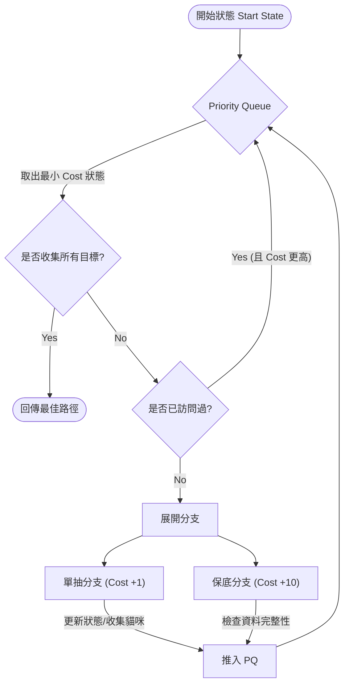

# 模擬器設計邏輯 (Simulator Design Logic)

## 核心演算法

模擬器使用 Dijkstra 演算法 (廣度優先搜尋的一種變體) 來搜尋達成目標的「最小花費 (Minimum Cost)」路徑。

## 狀態定義 (SearchState)

每個搜尋節點 (State) 包含以下資訊：

- **Cost**: 目前累積的抽卡次數。
- **Position**: 目前所在的格子 (ID 與 Track)。
- **Collected**: 目前已收集到的目標貓咪集合。

## 狀態轉換 (State Transition)

從任何一個狀態出發，我們可以執行兩種動作：

1. **單抽 (Single Roll)**:
    - 花費 +1。
    - 前進到下一格 (通常是同 Track, 除非遇到跳軌)。
    - 收集該格的貓咪。
2. **十連抽 (Guaranteed Roll)**:
    - 花費 +10。
    - 前進到指定的 `next_pos` (通常會跳軌)。
    - 收集接下來 10 格的貓咪 + 保底貓咪。

## 流程圖

