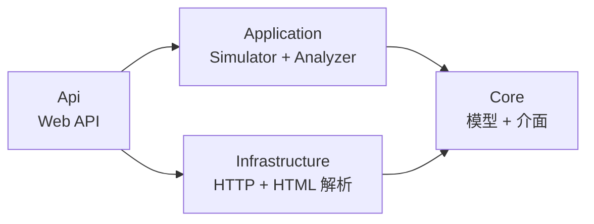
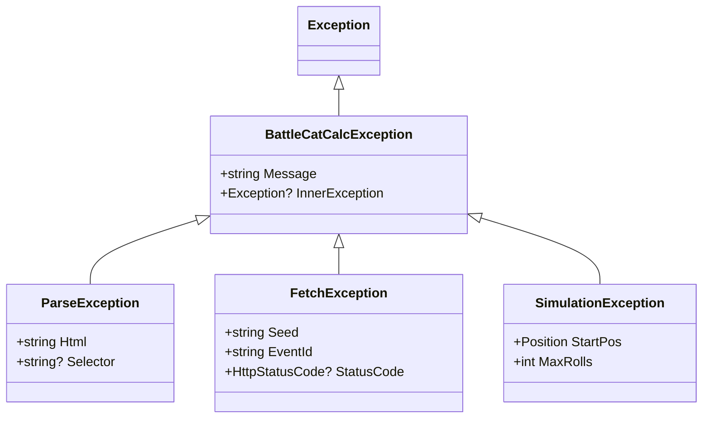

# 架構決策紀錄

> 建立日期：2026-03-29

## 分層架構

採用 Clean Architecture，由內而外四層：



### 依賴規則

- **Core** 不依賴任何其他專案，不引用外部 NuGet 套件
- **Infrastructure** 依賴 Core（實作介面），引用 AngleSharp
- **Application** 依賴 Core（使用模型與介面），不直接依賴 Infrastructure
- **Api** 依賴以上所有，負責 DI 組裝

### 為何不是兩層

Python 版將所有邏輯放在同一層級（`src/battle_cat_calc/`），可行但存在隱性耦合：

- `simulator.py` 直接取用 `Track` 物件，而非透過介面
- `parser.py` 的 HTML 解析邏輯與領域模型混合

分層後的優勢：

- Core 可獨立測試，不需 mock HTML 解析器
- Simulator 透過介面取得資料，可替換資料來源（檔案、API、快取）
- Infrastructure 可獨立替換（例如改用不同 HTML 解析器）

## 關鍵設計決策

### ADR-1: 模型使用 record / record struct

| Python | C# | 理由 |
|--------|----|------|
| `@dataclass` | `record class` | 值語意、內建 `Equals`/`GetHashCode`、`with` 表達式 |
| `@dataclass(frozen=True, slots=True)` | `readonly record struct` | 零配置不可變、堆疊配置、記憶體效率 |
| `frozenset` | `ImmutableHashSet<T>` 或 `FrozenSet<T>` (.NET 8+) | 不可變集合，可作為 Dictionary key |

**SearchState** 應為 `readonly record struct`：

- 大量建立（數十萬個），struct 避免 GC 壓力
- `frozen=True` 對應 `readonly`，編譯期保證不可變
- `order=True` 對應 `IComparable<T>` 實作

### ADR-2: Track 不繼承 List

Python 版 `Track` 繼承 `UserList` 取得列表 API。C# 中：

- 使用 **組合優於繼承**：`Track` 內含 `IReadOnlyList<GachaSlot>` 而非繼承
- 保留 `GetSlot(int id)` 的 O(1) 查找（內部 `Dictionary<int, GachaSlot>`）
- 實作 `IEnumerable<GachaSlot>` 以支援 LINQ

### ADR-3: 錯誤處理策略

| Python | C# | 場景 |
|--------|-----|------|
| `ValueError` | `ArgumentException` / 自訂 `ParseException` | 解析失敗 |
| `Optional[T]` | `T?`（nullable reference）或 `GachaSlot?`（nullable struct） | 搜尋未命中 |
| `httpx.HTTPStatusError` | `HttpRequestException` | 網路錯誤 |
| `ParseStatus` enum 哨兵值 | `SlotValue` discriminated union 或保留 enum | 解析異常標記 |

考慮使用 Result pattern（`OneOf<T, Error>` 套件）取代例外，特別是在 Simulator 的高頻路徑上。

#### 自訂例外層級



| 例外 | 所屬層 | 場景 |
|------|--------|------|
| `BattleCatCalcException` | Core | 專案例外基底類別，攜帶通用上下文 |
| `ParseException` | Infrastructure | HTML 結構不符預期、找不到轉蛋表格、欄位解析失敗 |
| `FetchException` | Infrastructure | HTTP 逾時、非 200 回應、連線失敗 |
| `SimulationException` | Application | 搜尋超出 max_rolls、無可行路徑、狀態不一致 |

設計原則：
- 基底類別定義於 Core，各層定義自己的衍生例外
- 每個例外攜帶足夠上下文資訊（seed、position、HTML 片段等），方便偵錯
- Controller 層統一捕獲 `BattleCatCalcException` 轉為適當的 HTTP 狀態碼

### ADR-4: 非同步邊界

- **Fetcher**：`async Task<string>`（HTTP I/O bound）
- **Parser**：同步（CPU bound、記憶體操作）
- **Simulator**：同步（CPU bound，Dijkstra 主迴圈不適合 async）
- **Api**：Controller 為 async（等待 Fetcher）

與 Python 版一致：僅 Fetcher 為非同步。

### ADR-5: PriorityQueue 使用策略

Python 版使用 `heapq`（min-heap），需手動管理。C# 內建 `PriorityQueue<TElement, TPriority>`：

```csharp
var pq = new PriorityQueue<SearchState, float>();
pq.Enqueue(state, state.Priority);
```

- 無需實作 `IComparable`（priority 獨立於 element）
- Beam Search 剪枝時，需用 `UnorderedItems` 取出再重建

### ADR-6: DI 策略

```csharp
// API 層註冊
services.AddHttpClient<IFetcher, BCDataFetcher>();
services.AddSingleton<IParser, BCParser>();
services.AddTransient<ISimulator, GachaSimulator>();
services.AddTransient<IAnalyzer, SeedAnalyzer>();
```

### ADR-7: 日誌策略

使用 `Microsoft.Extensions.Logging` 抽象層 + NLog 作為 Provider：

- 程式碼中僅依賴 `ILogger<T>`，不直接引用 NLog API
- NLog 負責實際輸出（Console、File 等 targets）
- 核心邏輯不綁定特定日誌框架，替換時只改 DI 註冊

```csharp
builder.Logging.ClearProviders();
builder.Logging.AddNLog();
```

- Fetcher 透過 `IHttpClientFactory` 管理連線池
- Parser 無狀態，可 Singleton
- Simulator 攜帶搜尋狀態，Transient

## 測試策略

| 層 | 測試重點 | Mock 對象 |
|----|---------|----------|
| Core.Tests | 模型建構、值相等、集合行為 | 無（純邏輯） |
| Infrastructure.Tests | HTML 解析正確性、HTTP 錯誤處理 | HttpClient（`MockHttpMessageHandler`） |
| Application.Tests | 路徑搜尋正確性、剪枝行為、邊界條件 | IParser 回傳預建 Track |
| fixtures/ | 與 Python 版共用 `seed_*_event_*.html` | — |

## API 端點設計（預定）

### 基本資訊

- 框架：ASP.NET Core Minimal API 或 Controller
- 路由前綴：`/api/v1`
- 回應格式：JSON（`System.Text.Json`）
- 錯誤回應：統一 Problem Details（RFC 9457）

### 端點規劃

| 方法 | 路徑 | 說明 | 對應模組 |
|------|------|------|---------|
| `GET` | `/api/v1/tracks` | 取得指定種子與活動的 Track A/B 資料 | Fetcher + Parser |
| `POST` | `/api/v1/simulate` | 執行路徑搜尋，回傳最佳路徑 | Simulator |
| `GET` | `/api/v1/cats/search` | 依名稱搜尋貓咪在軌道上的位置 | Analyzer |
| `GET` | `/api/v1/cats/guaranteed` | 搜尋指定貓咪的保底位置 | Analyzer |
| `GET` | `/api/v1/health` | 健康檢查 | — |

### Request / Response 範例

#### `GET /api/v1/tracks?seed=2127986414&event=1019&lang=tw&count=100`

```json
{
  "seed": "2127986414",
  "eventId": "1019",
  "trackA": [
    { "id": 1, "track": "A", "result": "貓咪陰陽師", "guaranteed": "第10使徒", "nextPos": { "id": 2, "track": "A" }, "isDuplicateRare": false }
  ],
  "trackB": [ ... ]
}
```

#### `POST /api/v1/simulate`

Request:
```json
{
  "seed": "2127986414",
  "pools": [
    { "eventId": "1019", "lang": "tw", "count": 200 },
    { "eventId": "1020", "lang": "tw", "count": 200 }
  ],
  "startPos": { "id": 1, "track": "A" },
  "targetCats": ["EVA初號機", "月影少年薰"],
  "maxRolls": 250,
  "beamWidth": null
}
```

Response:
```json
{
  "totalCost": 23,
  "stepCount": 15,
  "guaranteedCount": 2,
  "singleRollCount": 13,
  "collected": ["EVA初號機", "月影少年薰"],
  "startPos": { "id": 1, "track": "A" },
  "endPos": { "id": 24, "track": "B" },
  "path": [
    { "source": { "id": 1, "track": "A" }, "target": { "id": 2, "track": "A" }, "unit": "忍者貓", "poolId": "1019", "isGuaranteed": false }
  ]
}
```

#### 錯誤回應（Problem Details）

```json
{
  "type": "https://tools.ietf.org/html/rfc9457",
  "title": "Parse Error",
  "status": 422,
  "detail": "Cannot parse HTML: gacha table not found",
  "instance": "/api/v1/tracks?seed=2127986414&event=9999"
}
```

### 例外 → HTTP 狀態碼對應

| 例外 | HTTP Status | 說明 |
|------|-------------|------|
| `ParseException` | 422 Unprocessable Entity | HTML 結構無法解析 |
| `FetchException` | 502 Bad Gateway | 上游 bc.godfat.org 錯誤 |
| `SimulationException` | 400 Bad Request | 搜尋條件不合理（無可行路徑） |
| `ArgumentException` | 400 Bad Request | 參數驗證失敗 |
| 未預期例外 | 500 Internal Server Error | 記錄日誌，不洩漏內部細節 |
